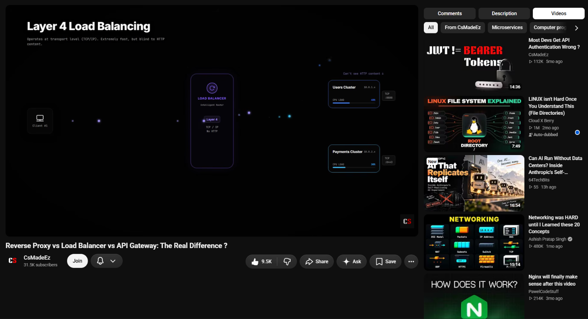

# ▶️ YouTube Fixed Video & Sidebar Tabs

A Tampermonkey userscript that keeps the YouTube video **pinned while you scroll** and moves **Comments, Description and Recommended Videos** into switchable tabs in the right sidebar.


---

## ❓ The Problem

On YouTube's watch page, the video scrolls out of view as soon as you read comments or browse recommendations. Moving comments to the sidebar doesn't fully solve it either: comments load endlessly, so you can never reach the recommended videos below them.

## ✅ The Fix

- 📌 **Fixed video:** the left column (video, title, buttons) stays pinned while you scroll.
- 🗂️ **Sidebar tabs:** `Comments | Description | Videos`. Only one shows at a time, so infinite comments never block the video list.
- 💾 **Remembers your tab:** the last tab you used opens by default on the next video.
- 🧭 **Sticky tab bar:** switch tabs from anywhere in the sidebar.



---

## ⚙️ Installation

1. Install **Tampermonkey** ([Chrome](https://chromewebstore.google.com/detail/tampermonkey/dhdgffkkebhmkfjojejmpbldmpobfkfo), [Firefox](https://addons.mozilla.org/firefox/addon/tampermonkey/), [Edge](https://microsoftedge.microsoft.com/addons/detail/tampermonkey/iikmkjmpaadaobahmlepeloendndfphd)).
2. **Chrome / Edge:** open `chrome://extensions` → Tampermonkey → **Details** → turn on **Allow User Scripts** (or enable **Developer mode**). Without this, userscripts don't run.
3. Tampermonkey icon → **Create a new script** → delete the template → paste the [code below](#-script-code) → `Ctrl + S`.
4. Open a YouTube video and hard refresh with `Ctrl + Shift + R`.
5. Press `F12`. The console should show `[YT-fix v12] loaded`.

> Disable any older YouTube sticky/layout scripts or Stylus rules first. They conflict with this one.

---

## 💻 Script Code

<details>
<summary>Click to expand the full script (v12.0)</summary>

```javascript
// ==UserScript==
// @name         YouTube Fixed Video & Right Comments
// @namespace    http://tampermonkey.net/
// @version      12.0
// @description  Video left me fixed; right sidebar me Comments / Description / Videos tabs.
// @match        https://www.youtube.com/*
// @run-at       document-start
// @grant        none
// ==/UserScript==

(function () {
    'use strict';
    console.log('[YT-fix v12] loaded');

    const TWO_COL = 'ytd-watch-flexy:not([theater]):not([fullscreen]):not([is-single-column])';
    const TABS = [['comments', 'Comments'], ['description', 'Description'], ['videos', 'Videos']];

    const css = `
        ytd-watch-flexy,
        ${TWO_COL} #columns {
            contain: none !important;
            overflow: visible !important;
        }
        ${TWO_COL} #columns { align-items: flex-start !important; }

        ${TWO_COL} #primary {
            position: sticky !important;
            top: 56px !important;
            align-self: flex-start !important;
            z-index: 10 !important;
        }
        ${TWO_COL} #primary-inner {
            display: flex !important;
            flex-direction: column !important;
            max-height: calc(100vh - 56px) !important;
        }
        ${TWO_COL} #primary-inner > #player { flex: none !important; }
        ${TWO_COL} #primary-inner > #below {
            flex: 1 1 auto !important;
            min-height: 0 !important;
            overflow-y: auto !important;
            scrollbar-width: none !important;
        }
        ${TWO_COL} #primary-inner > #below::-webkit-scrollbar { display: none !important; }

        /* ---- Tab bar ---- */
        #yt-fix-tabs {
            display: flex;
            gap: 8px;
            padding: 8px 0;
            position: sticky;
            top: 56px;
            z-index: 11;
            background: var(--yt-spec-base-background, #0f0f0f);
        }
        #yt-fix-tabs button {
            flex: 1;
            padding: 8px 6px;
            border: none;
            border-radius: 8px;
            cursor: pointer;
            font: 500 14px Roboto, Arial, sans-serif;
            color: var(--yt-spec-text-primary, #fff);
            background: var(--yt-spec-badge-chip-background, rgba(255,255,255,0.1));
        }
        ytd-watch-flexy[data-yt-tab="comments"]    #yt-fix-tabs button[data-tab="comments"],
        ytd-watch-flexy[data-yt-tab="description"] #yt-fix-tabs button[data-tab="description"],
        ytd-watch-flexy[data-yt-tab="videos"]      #yt-fix-tabs button[data-tab="videos"] {
            background: var(--yt-spec-text-primary, #fff);
            color: var(--yt-spec-base-background, #0f0f0f);
        }

        #yt-fix-desc { padding-bottom: 16px; }

        /* hide everything except the active tab */
        ytd-watch-flexy[data-yt-tab="comments"]    #secondary-inner #related,
        ytd-watch-flexy[data-yt-tab="comments"]    #secondary-inner #yt-fix-desc,
        ytd-watch-flexy[data-yt-tab="description"] #secondary-inner #comments,
        ytd-watch-flexy[data-yt-tab="description"] #secondary-inner #related,
        ytd-watch-flexy[data-yt-tab="videos"]      #secondary-inner #comments,
        ytd-watch-flexy[data-yt-tab="videos"]      #secondary-inner #yt-fix-desc {
            display: none !important;
        }
    `;

    const style = document.createElement('style');
    style.id = 'yt-fix-style';
    style.textContent = css;
    document.documentElement.appendChild(style);

    function getParts() {
        const flexy = document.querySelector('ytd-watch-flexy');
        const inner = flexy && flexy.querySelector('#secondary-inner');
        return { flexy, inner };
    }

    function setTab(tab) {
        const { flexy } = getParts();
        if (!flexy) return;
        flexy.dataset.ytTab = tab;
        try { localStorage.setItem('yt-fix-tab', tab); } catch (e) {}
        window.scrollTo({ top: 0 });
    }

    function ensureTabs() {
        if (location.pathname !== '/watch') return;
        const { flexy, inner } = getParts();
        if (!flexy || !inner) return;

        if (!flexy.dataset.ytTab) {
            let saved = null;
            try { saved = localStorage.getItem('yt-fix-tab'); } catch (e) {}
            flexy.dataset.ytTab = TABS.some(t => t[0] === saved) ? saved : 'comments';
        }

        // tab bar
        let bar = document.getElementById('yt-fix-tabs');
        if (!bar) {
            bar = document.createElement('div');
            bar.id = 'yt-fix-tabs';
            TABS.forEach(([key, label]) => {
                const b = document.createElement('button');
                b.dataset.tab = key;
                b.textContent = label;
                b.addEventListener('click', () => setTab(key));
                bar.appendChild(b);
            });
        }
        if (inner.firstElementChild !== bar) inner.prepend(bar);

        // description box (right below the tab bar)
        let box = document.getElementById('yt-fix-desc');
        if (!box) {
            box = document.createElement('div');
            box.id = 'yt-fix-desc';
        }
        if (bar.nextElementSibling !== box) bar.after(box);

        if (!box.firstElementChild) {
            const row = flexy.querySelector('ytd-watch-metadata #bottom-row');
            if (row) box.appendChild(row);
        }
    }

    function relocateComments() {
        if (location.pathname !== '/watch') return;
        const { flexy, inner } = getParts();
        if (!flexy || !inner) return;
        const comments = flexy.querySelector('ytd-comments#comments');
        if (!comments || inner.contains(comments)) return;

        const related = inner.querySelector('#related');
        if (related && related.parentElement) {
            related.parentElement.insertBefore(comments, related);
        } else {
            inner.appendChild(comments);
        }
    }

    function run() {
        ensureTabs();
        relocateComments();
    }

    let pending = false;
    const observer = new MutationObserver(() => {
        if (pending) return;
        pending = true;
        requestAnimationFrame(() => { pending = false; run(); });
    });

    window.addEventListener('yt-navigate-finish', run);
    observer.observe(document.documentElement, { childList: true, subtree: true });
})();
```

</details>

---

## 🔧 Configuration

| What | Where in the script | Default |
| ---- | ------------------- | ------- |
| Distance from top (YouTube's top bar height) | `top: 56px` and `100vh - 56px` in the CSS | `56px` |
| Tabs and their order | `const TABS = [...]` | Comments, Description, Videos |
| Default tab on first run | `... : 'comments'` inside `ensureTabs()` | `comments` |

---

## 🧠 How It Works

1. `position: sticky` only works if no parent element has `overflow` or `contain` set. The script clears these on YouTube's layout containers.
2. The left column `#primary` is made sticky with `align-self: flex-start`. It is not stretched, so it has room to stick while the taller sidebar scrolls.
3. Comments and the description box are moved into `#secondary-inner` (the sidebar). A small tab bar sets a `data-yt-tab` attribute on `ytd-watch-flexy`, and CSS shows only the active panel.
4. A throttled `MutationObserver` plus the `yt-navigate-finish` event re-apply everything when YouTube re-renders between videos.
5. The pinned layout is applied only in **two-column normal mode**. Theater, fullscreen and single-column layouts are left alone.

---

## 🛠️ Troubleshooting

| Problem | Fix |
| ------- | --- |
| Nothing changes | Turn on **Allow User Scripts**, make sure the script is enabled, then hard refresh. |
| No console log | The script isn't running. Check the version shown in the Tampermonkey dashboard. |
| Video doesn't stick, no tabs | YouTube is in **single-column layout** (window narrower than about 1016 px, or DevTools docked at the side). Widen the window or undock DevTools. |
| Two scripts fighting | Disable older sticky/layout userscripts and Stylus rules. |
| Description looks slightly different | It is moved out of YouTube's container, so some spacing or background can differ. |
| Broke after a YouTube update | An element may have been renamed. Run the debug snippet below and open an issue. |

<details>
<summary>🔍 Debug snippet (paste in the console on a watch page)</summary>

```javascript
(() => {
  const f = document.querySelector('ytd-watch-flexy');
  const p = f.querySelector('#primary');
  const blockers = [];
  for (let e = p.parentElement; e; e = e.parentElement) {
    const c = getComputedStyle(e);
    if (c.overflow !== 'visible' || c.contain !== 'none' || c.transform !== 'none')
      blockers.push(`${e.tagName}#${e.id} overflow=${c.overflow} contain=${c.contain} transform=${c.transform}`);
  }
  return JSON.stringify({
    width: innerWidth,
    attrs: [...f.attributes].map(a => a.name).join(' '),
    primaryPosition: getComputedStyle(p).position,
    tabsBar: !!document.getElementById('yt-fix-tabs'),
    tabAttr: f.dataset.ytTab || null,
    blockers
  }, null, 1);
})()
```

</details>

---

## 📄 License

MIT. Free to use, modify and share.
